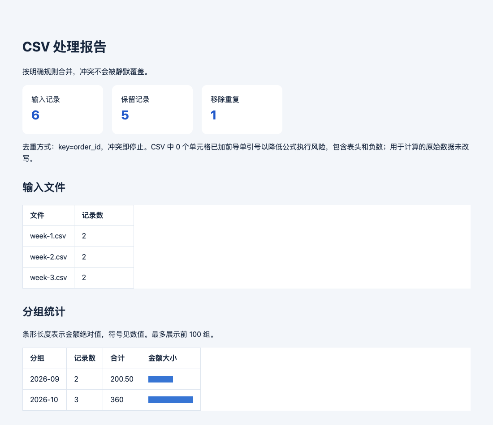
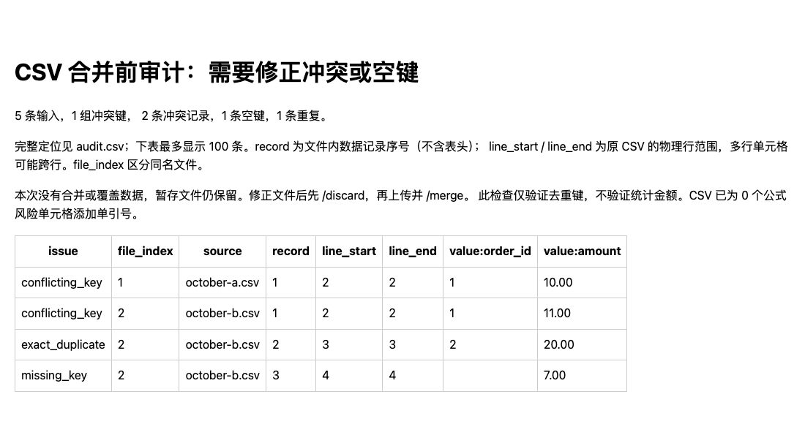

# Chat Task Bridge

Send CSV files through Feishu or Weixin, check conflicts, and get merged files back in the same conversation.

[中文](README.md) · [Local file processing](docs/product.md) · [v0.2.1 prerelease](https://github.com/crown-sports/chat-task-bridge/releases/tag/v0.2.1)



*Actual `report.html` from the bundled order demo. File processing is real; chat delivery uses a local simulator.*

For teams that regularly collect CSVs with the same columns. An administrator
runs the bridge; people send files and specify a key. They receive `merged.csv`,
`summary.json` and a readable HTML report. Conflicting rows with the same key
stop the merge instead of silently choosing a winner.

## See the result locally

Python 3.11+ on Linux or macOS; use WSL on Windows. No platform credentials or model required.

```sh
git clone --branch v0.2.1 https://github.com/crown-sports/chat-task-bridge.git
cd chat-task-bridge
python3 -m venv .venv
source .venv/bin/activate
python -m pip install -e .
chatbridge demo --output demo-output
```

Open `demo-output/feishu/report.html`: **6 rows become 5**, with monthly totals
of **200.50 and 360**. The `weixin/` directory contains the same result. Duplicate
attachment events are recorded once in the SQLite ledger. Use a new output
directory for a fresh run.

## Audit before merging



*Bundled conflict fixture: one conflicting key, one missing-key row and one duplicate. Original files are unchanged.*

Once deployed, the conversation flow is:

1. Send UTF-8 CSV files and receive a staging acknowledgement for each.
2. Send `/audit key=order_id` to get conflicts and source row locations.
3. After reviewing, send `/merge key=order_id group=month sum=amount`.
4. To replace files, use `/discard` and upload the corrected batch. `/status` shows jobs.

Audit keeps the staged files; merge consumes the batch. Audit checks keys, while
merge checks the amount format for aggregation. Column order may differ, but
column names must match. [Try your own CSVs without a platform](docs/product.md).

## Connect a platform

| Channel | Administrator setup | Guide |
| --- | --- | --- |
| Feishu | Application credentials, message permissions and allowed sender IDs | [Feishu](docs/feishu.md) |
| Personal Weixin | Supported account login and allowed sender IDs | [Weixin](docs/weixin.md) |
| Optional container execution | An OpenSandbox server and API key | [OpenSandbox](docs/opensandbox.md) |

**Preview:** real Weixin accounts, Feishu applications and an OpenSandbox server
have not yet been tested end to end. Start with an authorized test conversation.
CSV only: no XLSX, Weixin groups or natural-language tasks. The local executor
runs the bundled processor, with one worker per state directory. Unknown delivery
outcomes stop automatic retries. [Recovery behavior and limits](docs/validation.md).

[Validation](docs/validation.md) · [Security](SECURITY.md) · [Attribution](THIRD_PARTY.md) · MIT license
